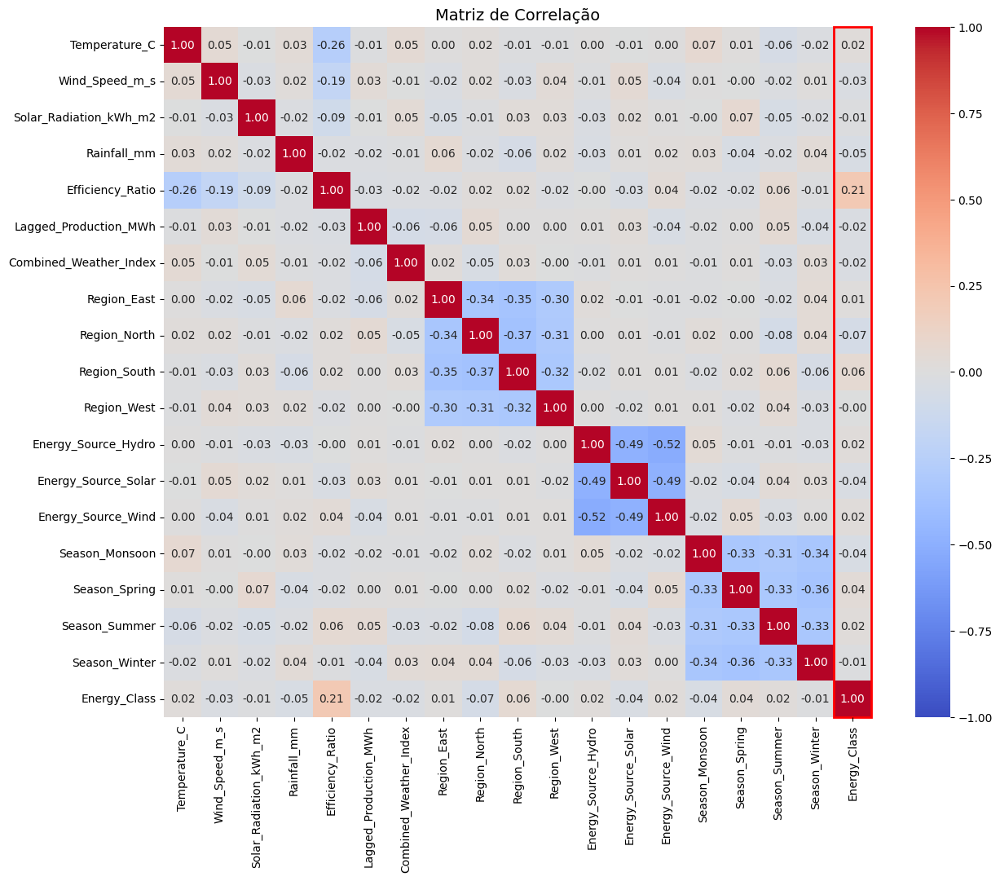
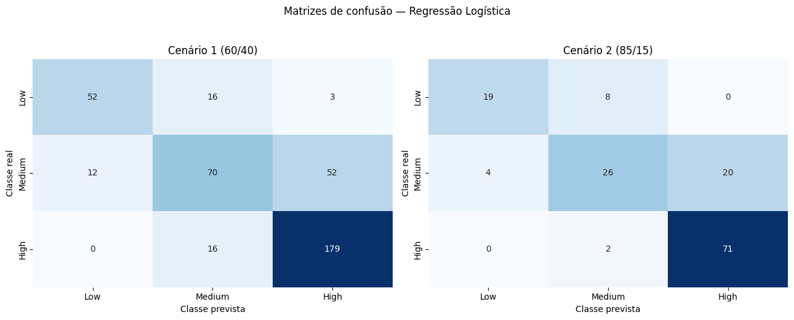
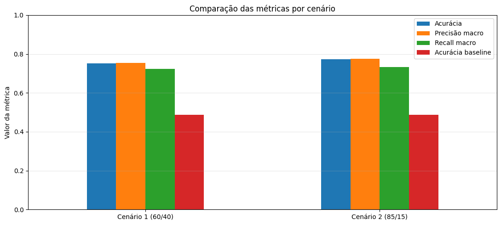

# Sprint 4 - Modelagem Linear para Aprendizado de Máquina

## Integrantes

| Nome completo | RM |
| --- | --- |
| Augusto de Souza Avila | 570839 |
| Davi Simoncelo | 571738 |
| João Pedro Sousa | 573962 |
| Matheus Evangelista | 568593 |
| Murilo Lima de Carvalho | 570156 |

---

## 1. Introdução

Essa atividade consiste na comparação de dois cenários de divisão de treino-teste de um modelo de classificação de um mesmo dataset. Cenário 1: 60 para treino 40 para teste; Cenário 2: 85 para treino e 15 para teste.

## 2. Base de Dados

A base utilizada nessa análise foi a **Renewable Energy Production Dataset (2010-2020)** disponibilizida pelo Rohit Burman na plataforma Kaggle.

O dataset oferece uma visão detalhada da produção de energia renovável (solar, eólica e hidrelétrica), classificada em categorias distintas com base nos níveis de produção. Os dados são complementados por parâmetros ambientais, como temperatura, velocidade do vento, radiação solar e precipitação, tornando-os ideais para modelos de aprendizado de máquina baseados em classificação.

Fonte: https://www.kaggle.com/datasets/itsrohithere/renewable-energy-production-dataset-2010-2020/data

---

## 3. Análise da Matriz de Correlação e Seleção dos Atributos

Com base na matriz de correlação gerada e na ordenação das correlações absolutas com a variável-alvo `Energy_Class`, podemos realizar as seguintes observações:

Associações com o alvo, ordenadas pela magnitude absoluta.

| Variável                   |  Valor |
|----------------------------|-------:|
| **Efficiency_Ratio**       |  0.211202 |
| **Region_North**           | -0.065402 |
| **Region_South**           |  0.056317 |
| **Rainfall_mm**            | -0.045958 |
| **Season_Monsoon**         | -0.044988 |
| **Season_Spring**          |  0.039044 |
| **Energy_Source_Solar**    | -0.035149 |
| **Wind_Speed_m_s**         | -0.027079 |
| **Combined_Weather_Index** | -0.024515 |
| **Lagged_Production_MWh**  | -0.023716 |
| **Season_Summer**          |  0.019553 |
| **Energy_Source_Hydro**    |  0.018621 |
| **Temperature_C**          |  0.017666 |
| **Energy_Source_Wind**     |  0.015827 |
| **Season_Winter**          | -0.013876 |
| **Region_East**            |  0.012061 |
| **Solar_Radiation_kWh_m2** | -0.007859 |
| **Region_West**            | -0.003936 |

1. **Baixa Correlação Linear Geral:** 
   * A variável `Efficiency_Ratio` apresenta a maior correlação linear com o alvo, porém ainda é considerada uma correlação fraca a moderada (~0.21).
   * Todas as outras variáveis numéricas e categóricas (como as regiões, fontes de energia e estações do ano) apresentam correlações extremamente baixas com o alvo (abaixo de 0.07 em módulo).

2. **Ausência de Multicolinearidade Forte:** 
   * Entre as variáveis preditoras numéricas (`Temperature_C`, `Wind_Speed_m_s`, `Solar_Radiation_kWh_m2`, `Rainfall_mm`, `Efficiency_Ratio`, `Lagged_Production_MWh`), as correlações são próximas de zero, exceto por uma correlação fraca e negativa entre `Temperature_C` e `Efficiency_Ratio` (~ -0.26).
   * Isso indica que não há redundância de informação (multicolinearidade) óbvia que nos force a remover variáveis numéricas para evitar instabilidade em modelos lineares.

Portanto **É mais apropriado utilizar todas as features disponíveis**. Pois:

* Como as correlações lineares individuais de quase todas as variáveis com o alvo são muito baixas, se descartássemos features puramente por possuírem baixa correlação linear individual, acabaríamos excluindo quase todo o dataset.
* Relações complexas ou não-lineares, além de interações combinadas entre múltiplos atributos, podem ser cruciais para que o modelo de classificação estabeleça sua fronteira de decisão. .
* Por isso, manter todas as variáveis nos dá uma maior garantia de que não estamos jogando fora informações potencialmente úteis quando combinadas.

---

## 4. Modelo, resultados e comparações

Para este problema de classificação multiclasse, o modelo linear selecionado do foi a **Regressão Logística (Logistic Regression)**.

Resumo das métricas nos dois cenários:

| Cenário | Treino (%) | Teste (%) | N treino | N teste | Acurácia | Precisão| Recall macro | Acurácia baseline |
|---|---:|---:|---:|---:|---:|---:|---:|---:|
| Cenário 1 (60/40) | 60 | 40 | 600 | 400 | 0.752 | 0.755 | 0.724 | 0.487 |
| Cenário 2 (85/15) | 85 | 15 | 850 | 150 | 0.773 | 0.776 | 0.732 | 0.487 |

Relatório por classe - Cenário 1 (60/40)

|                  | **precision** | **recall** | **f1-score** | **support** |
|-----------------:|--------------:|-----------:|-------------:|------------:|
|          **Low** |         0.829 |      0.479 |        0.607 |        71.0 |
|       **Medium** |         0.659 |      0.634 |        0.646 |       134.0 |
|         **High** |         0.800 |      0.944 |        0.866 |       195.0 |
|    **macro avg** |         0.763 |      0.686 |        0.706 |       400.0 |
| **weighted avg** |         0.758 |      0.758 |        0.746 |       400.0 |
|     **accuracy** |               |            |        0.758 |       400.0 |

Relatório por classe — Cenário 2 (85/15)

|                  | **precision** | **recall** | **f1-score** | **support** |
|-----------------:|--------------:|-----------:|-------------:|------------:|
|          **Low** |         0.783 |      0.667 |        0.720 |        27.0 |
|       **Medium** |         0.689 |      0.620 |        0.653 |        50.0 |
|         **High** |         0.829 |      0.932 |        0.877 |        73.0 |
|    **macro avg** |         0.767 |      0.739 |        0.750 |       150.0 |
| **weighted avg** |         0.774 |      0.780 |        0.774 |       150.0 |
|     **accuracy** |               |            |        0.780 |       150.0 |

Comparação direta (85/15 menos 60/40)

| Métrica | Cenário 1 (60/40) | Cenário 2 (85/15) | Diferença |
|---|---:|---:|---:|
| Acurácia | 0.752 | 0.773 | +0.021 |
| Precisão macro | 0.755 | 0.776 | +0.022 |
| Recall macro | 0.724 | 0.732 | +0.008 |

A avaliação do cenário 85/15 mostrou acurácia maior neste particionamento. Isso pode estar relacionado ao maior volume de treino, mas a comparação também depende da amostra de teste e não prova, por si só, que a proporção 85/15 seja sempre melhor.

Limitações da comparação: os dois cenários mudam simultaneamente o número de exemplos disponíveis para treinar e para testar. O teste maior (40%) produz métricas calculadas em mais observações, geralmente com menor variabilidade amostral, mas deixa menos dados para o ajuste. O teste menor (15%) libera mais dados para treinamento, mas poucas previsões incorretas a mais ou a menos podem alterar as métricas de forma perceptível. Para conclusões mais robustas, seria útil repetir as divisões ou usar validação cruzada, mantendo um conjunto de teste final independente.

---

### Avaliação da Adequação do Desempenho do Modelo

Com base nos relatórios de métricas, gráficos e matrizes de confusão gerados anteriormente, podemos avaliar criticamente o desempenho do modelo de Regressão Logística para o problema de classificação de classes de energia (`Low`, `Medium` e `High`).

#### Análise dos Resultados das Métricas

*   **Acurácia Global (aproximadamente 75% a 77%):**
    O modelo superou significativamente o **baseline de acurácia (aproximadamente 48.7%)**, que representa a proporção da classe mais frequente no conjunto de teste. Isso prova que as variáveis preditoras carregam sinal útil e o modelo de fato aprendeu padrões relevantes, não realizando apenas previsões aleatórias ou tendenciosas para a classe majoritária.
*   **Precisão Macro (aproximadamente 75% a 77%) e Recall Macro (aproximadamente 72% a 73%):**
    Como as métricas macro calculam a média simples sem ponderar pelo suporte de cada classe, esses valores próximos à acurácia global mostram que o modelo mantém um desempenho equilibrado entre as diferentes classes, sem negligenciar completamente nenhuma delas.

#### Desempenho Detalhado por Classe (Análise das Matrizes de Confusão)

Analisando individualmente o comportamento das classes, identificamos padrões claros de comportamento:

*   **Classe High (Alta Produção):**
    Apresenta excelente desempenho. No Cenário 1, de 195 casos reais de classe 'High', 179 foram classificados corretamente (aproximadamente 91.7% de recall). Quase não há confusão de 'High' com 'Low' (0 casos). Isso sugere que a assinatura de alta produção de energia é muito bem delimitada pelas variáveis de entrada (como o `Efficiency_Ratio`).
*   **Classe Low (Baixa Produção):**
    Possui uma performance satisfatória. No Cenário 1, obteve cerca de 73% de recall (52 de 71 casos reais) e alta precisão. Pouquíssimos casos de 'Low' são confundidos como 'High' (apenas 3 casos).
*   **Classe Medium (Média Produção):**
    É o principal gargalo do modelo. No Cenário 1, de 134 casos reais de 'Medium', apenas 70 foram identificados corretamente (aproximadamente 52% de recall). O modelo frequentemente confunde a classe 'Medium' classificando-a como 'High' (52 casos) ou 'Low' (12 casos). Como 'Medium' é uma classe intermediária, suas fronteiras de decisão se sobrepõem naturalmente com as outras duas, dificultando uma separação perfeita por meio de um hiperplano linear.

Para um algoritmo mais simples e interpretável como a Regressão Logística, obter uma acurácia superior a 75% em um problema multiclasse (onde o acaso seria 33.3% e o baseline é 48%) é um resultado robusto e adequado para a primeira iteração.

---

### Discussão sobre o Tamanho do Conjunto de Teste (Vantagens e Limitações)

A escolha da proporção entre dados de treino e teste representa um clássico balanço (*trade-off*) no desenvolvimento de modelos de Machine Learning, envolvendo dois aspectos conflitantes: a **qualidade do ajuste do modelo** e a **confiabilidade da avaliação da sua performance**.

#### Conjunto de Teste Menor (ex: 15% de teste / 85% de treino)

*   **Vantagens:**
    *   **Mais dados para o treinamento:** O modelo tem acesso a uma maior quantidade e diversidade de exemplos para ajustar seus pesos e interceptos. Em datasets pequenos (como o nosso, com 1000 amostras), dispor de 850 dados de treino em vez de 600 é uma vantagem expressiva que permite ao estimador capturar melhor os padrões reais dos dados.
    *   **Melhor generalização:** Com mais dados de treino, reduz-se o risco de subajuste (*underfitting*), permitindo que o modelo aprenda de forma mais robusta.

*   **Limitações:**
    *   **Menos confiabilidade estatística na avaliação:** Avaliar o modelo em apenas 150 amostras (Cenário 2) faz com que as métricas de validação sejam estatisticamente menos estáveis e altamente sensíveis a pequenas flutuações. Acertos ou erros em pouquíssimas amostras podem alterar drasticamente a acurácia, gerando uma avaliação com alta variância.
    *   **Dificuldade de representação de classes minoritárias:** Se uma das classes for muito rara, um conjunto de teste muito pequeno corre o risco de não conter amostras suficientes dela para uma avaliação de recall e precisão fidedigna.

#### Conjunto de Teste Maior (ex: 40% de teste / 60% de treino)

*   **Vantagens:**
    *   **Avaliação de performance altamente confiável e estável:** Avaliar o modelo com 400 amostras (Cenário 1) garante um cálculo de métricas muito mais representativo da realidade de produção. A variância do estimador da métrica de teste é menor, significando que o resultado obtido é estatisticamente mais próximo do erro real do modelo.
    *   **Melhor representatividade:** Há maior garantia de que todas as classes e subgrupos de dados (como combinações de regiões e fontes de energia) estarão bem representados no momento da validação.

*   **Limitações:**
    *   **Privação de dados para o treino:** Ao reter 40% dos dados, restam apenas 600 amostras para o algoritmo aprender. O modelo pode não alcançar seu potencial máximo de performance simplesmente por falta de exemplos históricos suficientes no treinamento, o que pode prejudicar seu desempenho final.

---
